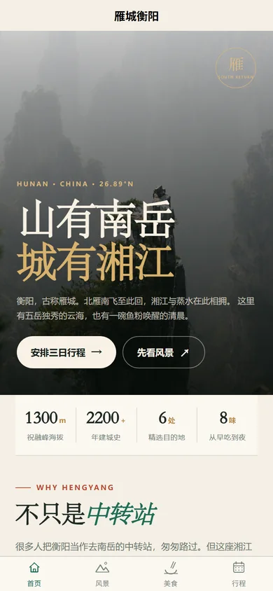
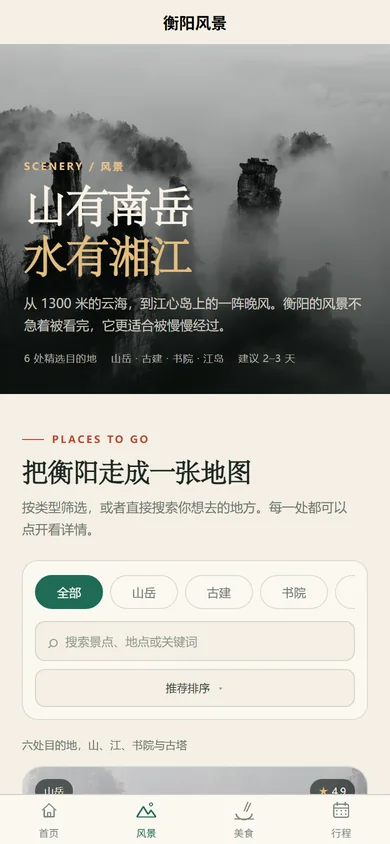
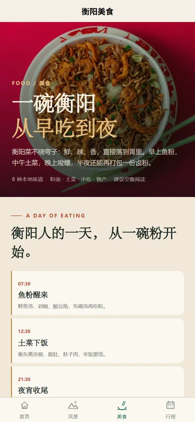
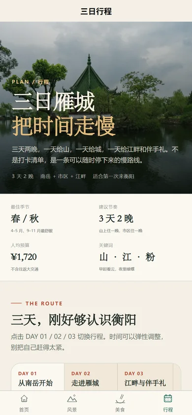
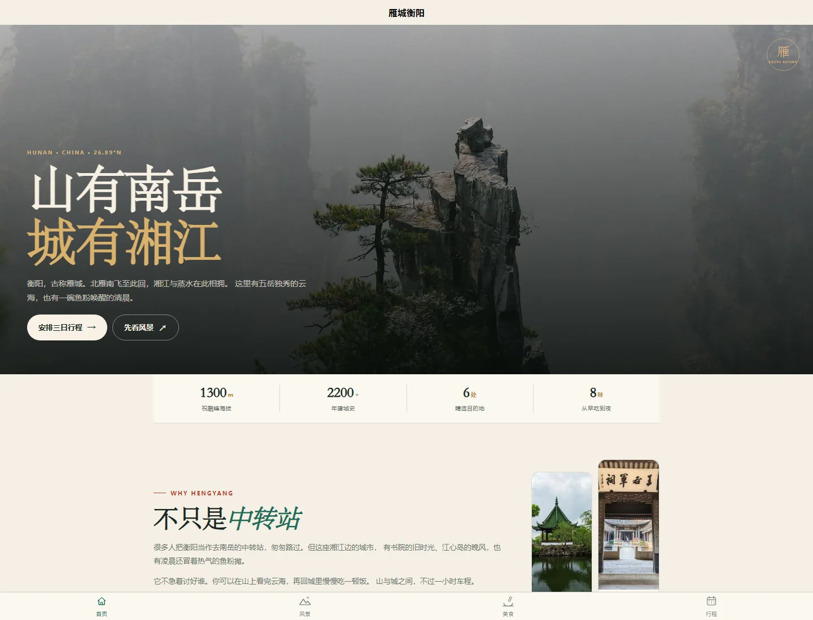

# 雁城衡阳 · uni-app 跨端旅行指南

把上一实验的 Vue 3 衡阳旅行网站迁移为 **uni-app（Vue 3）** 项目，一套代码同时构建 H5、微信小程序和 App 资源。

**在线 H5：** <https://asuka060108.github.io/hengyang-uniapp/>



## 页面预览

| 首页 | 风景 | 美食 | 行程 |
| --- | --- | --- | --- |
|  |  |  |  |

桌面端预览：



## 功能

- **首页**：沉浸式 Hero、衡阳简介、数据统计、精选风景/美食、三日行程预览、出行提示。
- **风景**：6 处目的地、分类筛选、关键词搜索、评分/名称排序、景点详情弹层。
- **美食**：8 种本地味道、分类筛选、搜索、辣度排序、收藏清单、本地持久化。
- **行程**：DAY 01/02/03 时间线、预算计算器（方式/天数/人数）、行前清单勾选与持久化、交通提示。
- **跨端适配**：原生 tabBar、`safe-area`、`image` 裁剪模式、`scroll-view` 横向筛选、无 `window/document` 依赖。
- **日/夜主题**：设置保存在本机，页面根节点统一切换 CSS 变量。

## 技术栈

| 项目 | 版本 |
| --- | --- |
| uni-app 编译器 | 5.34（Vue 3） |
| Vue | 3.4.21 |
| Vite | 5.2.8 |
| uni-app npm 包 | `3.0.0-5030420261029002` |
| HBuilderX | 5.34.2026102909 |
| 样式 | 原生 CSS + CSS 变量 + `px` 响应式断点 |

项目共 **19 个 Vue 单文件组件**：`App.vue` + 4 个页面 + 14 个可复用组件，覆盖 `script setup`、`ref/computed/watch`、props/emits、`v-model`、插槽、组合式函数、本地存储、列表筛选和弹层交互。

## 目录

```text
exp5/
├── src/
│   ├── pages/
│   │   ├── index/index.vue
│   │   ├── scenery/scenery.vue
│   │   ├── food/food.vue
│   │   └── plan/plan.vue
│   ├── components/            # 14 个跨端组件
│   ├── composables/           # useTheme / useFavorites
│   ├── data/                  # 景点、美食、行程数据
│   ├── utils/assets.js        # 静态资源路径与 tab 跳转
│   ├── static/                # 图片、tabBar 图标
│   ├── styles/main.css
│   ├── pages.json             # 页面、tabBar、导航栏
│   ├── manifest.json          # 各端配置
│   ├── App.vue
│   └── main.js
├── docs/
│   ├── migration-notes.md
│   └── screenshots/
├── android/                   # Android APK 封装（WebView）
│   ├── AndroidManifest.xml
│   ├── java/.../MainActivity.java
│   └── build_apk.py
├── index.html
├── vite.config.js
└── package.json
```

## 本地运行

```bash
cd exp5
pnpm install

# H5（默认 http://localhost:5173/hengyang-uniapp/）
pnpm dev:h5

# 微信小程序：生成 dist/dev/mp-weixin
pnpm dev:mp-weixin

# App：生成 dist/dev/app
pnpm dev:app
```

构建：

```bash
pnpm build:h5          # dist/build/h5
pnpm build:mp-weixin   # dist/build/mp-weixin
pnpm build:app         # dist/build/app
```

## 用 HBuilderX 运行

1. 下载并解压 **HBuilderX 5.34**（Windows 标准版即可）。
2. 打开 HBuilderX，选择“文件 → 导入 → 从本地目录导入”，选择本目录 `exp5`。
3. **运行到浏览器**：运行 → 运行到浏览器 → Chrome/Edge。
4. **运行到微信小程序**：运行 → 运行到小程序模拟器 → 微信开发者工具。首次使用需在 HBuilderX 设置中配置微信开发者工具路径。
5. **运行到 Android**：连接 Android 手机并开启 USB 调试，运行 → 运行到手机或模拟器 → Android；或在“发行 → 原生 App-云打包”中生成 APK。

HBuilderX 已实际导入并编译通过本项目：

```text
项目 exp5 编译成功。
编译器版本：5.34（vue3）
```

因为当前机器没有安装微信开发者工具、Android SDK/模拟器，且未登录 DCloud 账号，所以只完成了编译与构建产物；Android 另生成了可安装的 WebView 壳 APK，但未做真机安装测试。具体状态见下文“验证情况”。

## 微信小程序

1. 在 `src/manifest.json` 中把 `mp-weixin.appid` 改成自己的微信小程序 AppID（当前使用测试 AppID `touristappid`）。
2. 执行 `pnpm build:mp-weixin`。
3. 打开微信开发者工具，导入 `dist/build/mp-weixin`。
4. 在开发者工具中预览、真机调试或上传体验版。

小程序端已处理：

- `pages.json` 原生 tabBar；
- 本地图片使用 `/static/images/...`；
- `localStorage` 改为 `uni.getStorageSync/setStorageSync`；
- `Teleport` 改为页面内固定定位弹层；
- 打开景点详情时调用 `uni.hideTabBar()`，关闭时恢复；
- 不使用 `window`、`document`、`IntersectionObserver` 等 Web-only API。

## Android / App

项目已生成 App 资源：

```text
dist/build/app
```

### 可安装 APK（WebView 封装）

下载：

<https://github.com/asuka060108/hengyang-uniapp/releases/download/v1.0.1/hengyang-uniapp.apk>

本地路径：`dist/hengyang-uniapp.apk`  
包名：`com.asuka.hengyang`  
版本：1.0.1（versionCode 2）  
最低系统：Android 7.0（API 24）  
SHA-256：`7975136fb2cd3f1e74c161bd7012f025cf9fa3bf09830239bc03b558e0c7f876`

> v1.0.1 修复了首次启动闪退：v1.0.0 的 DEX 只打包了 `MainActivity`，漏掉了内部类 `MainActivity$LocalAssetClient`；现在已把全部 `.class` 交给 D8，并用 `apkanalyzer` 确认内部类存在。

> 这是把 uni-app 的 **H5 构建产物**打包进 Android WebView 的可安装 APK，用于当前无法登录 DCloud 云打包的环境。它**不是 DCloud 原生 App 运行时**，但页面、筛选、收藏、清单、tabBar 等业务功能与 H5 一致，且离线加载 `assets`，不申请网络权限。

如需真正的 DCloud 原生 App APK，请用 HBuilderX 打开项目后执行“发行 → 原生 App-云打包”，需要：

- 登录 DCloud 账号；
- 填写 Android 包名，例如 `com.asuka.hengyang`；
- 选择公共测试证书或自有 keystore；
- 可选配置 App 图标、启动图、权限。

当前环境没有 Android 设备/模拟器，也没有完成 DCloud 登录，因此原生运行时 APK 未生成；App 资源与 HBuilderX 编译均已验证，WebView APK 已构建并签名。

## 验证情况

| 终端 | 方式 | 结果 |
| --- | --- | --- |
| H5 | `pnpm build:h5` + 本地静态服务器 | 通过；390×844 与 1440×1100 截图验证 |
| H5 交互 | 无头 Edge + CDP | 分类筛选、景点弹窗、tabBar 切换均通过 |
| 微信小程序 | `pnpm build:mp-weixin` | 通过；输出 `dist/build/mp-weixin` |
| 微信小程序 | HBuilderX `launch mp-weixin --compile true` | 编译通过；未安装微信开发者工具，未打开模拟器 |
| App | `pnpm build:app` | 通过；输出 `dist/build/app` |
| App | HBuilderX `launch app-android --compile true` | 编译通过；无已连接设备，未运行 |
| Android APK | Android SDK 35 + `android/build_apk.py` | 已生成并签名；WebView 封装，未真机安装 |
| Android 原生 APK | HBuilderX 云打包 | 未完成：需要 DCloud 登录/证书 |

## 迁移说明

从 `exp4` 的 Vue Router 单页应用迁移到 uni-app，主要改动：

- `vue-router` → `pages.json` + 原生 tabBar + `uni.switchTab`；
- `div/section/img/h1` → `view/text/image`；
- `localStorage` → `uni.getStorageSync/setStorageSync`；
- `Teleport` 弹层 → 页面内 `position: fixed` 弹层；
- `Transition/TransitionGroup` → 页面内 CSS 过渡；
- `v-reveal` 自定义指令 → 移除，保留页面级轻量动画；
- `window.scrollTo` → `uni.pageScrollTo`；
- `document.title` → 页面 `navigationBarTitleText`；
- `RouterLink` → `view` + `uni.switchTab`。

详细对照见 [docs/migration-notes.md](docs/migration-notes.md)。

## 已知限制

- 小程序端未能在微信开发者工具中做真机截图，原因是当前机器未安装开发者工具；构建产物可直接导入。
- Android 已生成 **WebView 封装 APK**，但未在真机/模拟器上安装验证；它不是 DCloud 原生 App 运行时。
- 真正的 DCloud Android 原生 APK 需要登录 DCloud 账号后进行云打包；当前环境没有账号和 Android 设备/模拟器。
- 微信小程序 AppID 目前为测试值，正式发布前请替换。
- 图片来自 Pexels 与旅行氛围素材，仅用于课程作业展示。

## 相关链接

- H5：<https://asuka060108.github.io/hengyang-uniapp/>
- 源码仓库：<https://github.com/asuka060108/hengyang-uniapp>
- 上一版 Vue 项目：<https://github.com/asuka060108/hengyang-vue-travel>
- uni-app 官方文档：<https://uniapp.dcloud.net.cn/>
- HBuilderX 快速上手：<https://uniapp.dcloud.net.cn/quickstart-hx.html>
